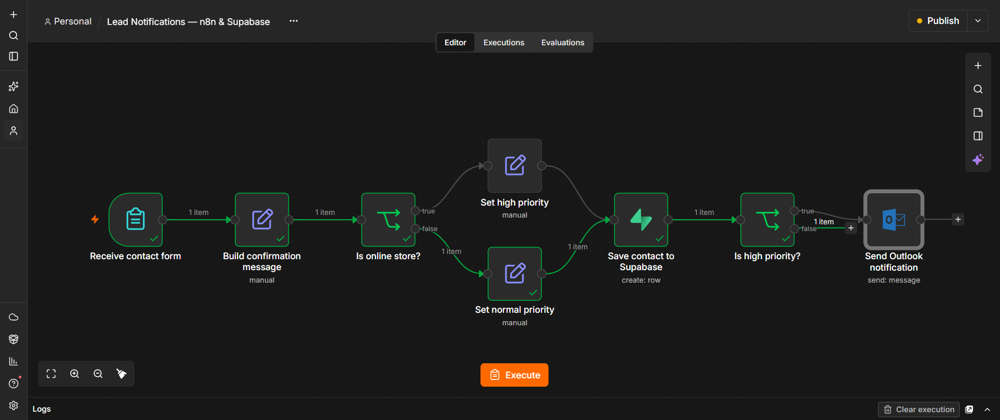
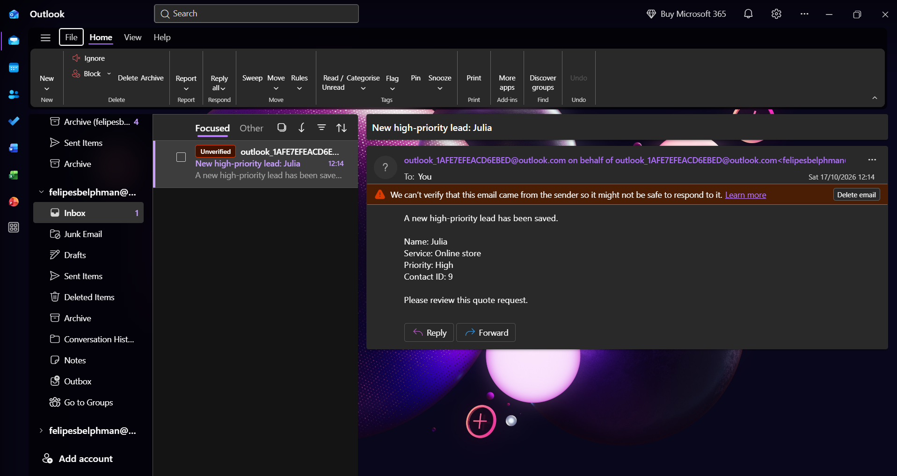

# Lead Notifications — n8n & Supabase

A portfolio project that captures quote requests, assigns priority using a business rule, saves contacts to Supabase, and sends an internal Outlook email notification for high-priority leads.

## How it works

1. A visitor submits their name and requested service.
2. The workflow builds a confirmation message for storage.
3. Requests for `Online store` receive `High` priority.
4. Other requests receive `Normal` priority.
5. The contact is saved to Supabase.
6. High-priority contacts trigger an Outlook email notification.

The priority rule is a fictional example and can be adapted to different business requirements.

## Technologies

- n8n
- Supabase / PostgreSQL
- Microsoft Outlook

## Tested scenarios

| Requested service | Priority | Saved to database | Email notification |
| --- | --- | --- | --- |
| Online store | High | Yes | Yes |
| Landing page | Normal | Yes | No |

Both paths were tested manually using fictional contact data.

## Email delivery observation

The test notification was received but initially went to Junk Email. After it was marked as not junk, it appeared in the Inbox. Outlook still displayed an unverified-sender warning; this remains unresolved.

## Current scope

This learning project demonstrates form capture, conditional routing, database storage, and email integration.

The generated confirmation message is stored in the database. It is not emailed to the person submitting the form.

Deduplication, advanced validation, and dedicated error handling are planned improvements.

## Related projects

- [Contact Capture](https://github.com/felipesbelphman-web/n8n-contact-capture)
- [Lead Qualification](https://github.com/felipesbelphman-web/n8n-lead-qualification)

## Screenshots

### Workflow
Captures contacts, assigns priority, saves data to Supabase, and sends Outlook notifications for high-priority leads.

### Email notification
Example notification received during a test with fictional contact data.

